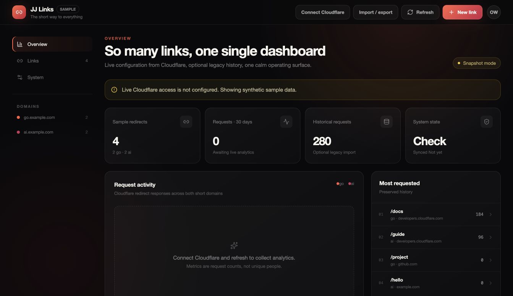

# JJ Links Open

**So many links, one single dashboard.**

A private dashboard for branded short links that runs entirely in **your Cloudflare account**. Workers hosts the application, D1 stores your backups and analytics, and Cloudflare Access protects it using your existing Cloudflare sign-in. No OpenAI Sites, ChatGPT subscription or AI API is needed to run it.

Cloudflare Bulk Redirects keeps serving your links directly. Closing or taking the dashboard offline does not stop redirects.

[](https://deploy.workers.cloudflare.com/?url=https://github.com/jardenberg/jj-links-open)



## JJ Links in the wild

Johannes Sundlo ([@FullStackHR](https://www.youtube.com/@FullStackHR)) describes using JJ Links for his `sundlo.link` short links in **Tack!**, a 57-second video in Swedish. He covers searching and adding links, request activity, pre-update backups, and why redirects keep working even when the dashboard is offline.

[](https://www.youtube.com/shorts/Oz_TT2oBeW8)

A community example, as described by its owner. For current installation instructions, follow the [setup guide](docs/DEPLOYMENT.md).

## Start here, even if you are not technical

You need a Cloudflare account, control of your short-link domains, and a GitHub account for the deployment button to copy the source. Your copy can be private.

1. **Click Deploy to Cloudflare.** Follow the Cloudflare screens to create your Worker and D1 database. The database migrations run during deployment.
2. **Protect the dashboard with Cloudflare Access.** Allow only your exact Cloudflare account email and protect all traffic to this Worker. Add the team hostname, application audience and owner email to the Worker's settings. Until then, the application shows a locked setup page.
3. **Connect your redirect account.** Store a narrowly scoped Cloudflare API token as a secret, then set the account ID, zone ID and your two short hostnames.
4. **Open Connect Cloudflare in the dashboard.** Pick your existing Bulk Redirect List by name. The app checks that its redirect rule is enabled and the list belongs to your configured hosts.

The button provisions the application and database. Access setup and permission to manage your redirects are separate account decisions, so they are guided steps rather than hidden automatic changes. [Follow the complete setup guide](docs/DEPLOYMENT.md).

## Let an AI assistant do the technical work

You do not need to operate Git or a terminal yourself. Give a capable coding assistant this prompt. It needs browser/terminal or Cloudflare tools to perform the work; a chat without those tools can still guide you.

```text
Help me install JJ Links Open in my Cloudflare account:
https://github.com/jardenberg/jj-links-open

Read the current README, docs/DEPLOYMENT.md and SECURITY.md first. Use the
Cloudflare-native version, not the old OpenAI Sites adapter.

I want a private dashboard for two short-link hostnames. Keep explanations brief
and practical. Handle the code, database migrations and configuration with your
tools, and tell me exactly which account decisions or sign-in steps I must do.

Use Workers + D1 + Cloudflare Access, with an Allow policy for only my exact
Cloudflare account email. Prefer Cloudflare's existing sign-in for the simplest
setup. Protect all Worker traffic, not previews alone. Verify the signed Access
token in the application. Never enable
a production authentication bypass or trust an email header without verification.

Do not ask me to paste passwords or API tokens into chat. Guide me to enter the
Cloudflare token directly into Cloudflare's secret field. Scope it to my selected
account and zone. Keep real redirect exports and analytics out of public Git.

Ask which two short domains I want and whether I already have a Bulk Redirect
List. Use the Deploy to Cloudflare flow when possible. Do not change DNS, replace
an existing production list, change repository visibility, purchase a plan or
accept an overage-billing authorization without my confirmation of the exact
change.

Before calling the installation ready, verify anonymous access is rejected,
the allowed owner can sign in, the correct list is selected, the full inventory
count matches Cloudflare, CSV export downloads correctly, and a harmless CSV
preview proposes the expected changes without applying them.

If a tool or permission is missing, say what is missing and continue the work
that does not depend on it. Do not claim deployment from a passing build alone.
```

## What you get

- Search across every short URL, destination and note.
- Create and edit redirects with collision checks and public-response verification.
- Cloudflare request activity, kept separate from optional legacy metrics.
- CSV export and pre-import backups.
- CSV merge that keeps links missing from the file.
- Full-backup restore with a deletion preview and a typed confirmation.
- Stored snapshots, audit records, serialized writes and safe request replay.

Bundled redirect and analytics fixtures are synthetic. Your actual mappings, notes and analytics stay in your own Cloudflare services.

## CSV import and restore

Open **Import / export**, select a configuration CSV and choose:

- **Merge:** add or update the listed links; keep all others.
- **Restore:** make the whole list match the backup, including removals.

Nothing changes during preview. Review the destinations, status codes, matching options and notes. Confirm the proposed changes; restore additionally requires typing the current list count. The app saves the complete before-state and stops if the live list changed after your preview.

After saving, download the pre-import backup and watch public verification progress. Pending edge checks do not mean the configuration failed. An interrupted import can be reopened in the same browser tab without submitting the write twice.

The first standalone workflow supports **up to 1,000 live links and a 1 MB CSV**. Very long destinations or notes can reach the database preview-size limit sooner; the app refuses the preview without changing Cloudflare. Analytics exports, including segmented Rebrandly click reports, are not configuration backups. [CSV format and examples](docs/CSV.md).

## Try the sample locally

For developers or an assistant operating a terminal, Node.js 22.13 or later is required:

```bash
git clone https://github.com/jardenberg/jj-links-open.git
cd jj-links-open
npm ci
npm run dev
```

Open the printed loopback URL. Sample mode needs no credentials, cannot administer live Cloudflare data, and supports read-only CSV previews. A production build always requires Cloudflare Access; the local sample identity is not shipped as a runtime bypass.

```bash
npm test
npm run typecheck
npm run lint
npm run build
npm audit
```

## Architecture, costs and limits

The runtime uses Cloudflare Workers, static assets, D1 and Access. The code contains no OpenAI service calls. GitHub stores the source; Cloudflare can build and deploy it.

Cloudflare usage and domain renewals remain subject to your account's plans and limits. This project does not promise that every installation is free. [Cloudflare Workers pricing](https://developers.cloudflare.com/workers/platform/pricing/).

This is intentionally a small, single-owner tool: one account, one zone, two short hostnames and one active redirect list. Use one administrative writer at a time; external console/API edits can still race a full-list replacement. [Architecture](docs/ARCHITECTURE.md) · [Security](SECURITY.md) · [Changelog](CHANGELOG.md).

Existing private Sites installations can stay on their established code. Upgrading an existing Sites deployment to this public version requires a deliberate authentication and hosting migration.

## Contribute and make it yours

Issues and focused pull requests are welcome. Read [Contributing](CONTRIBUTING.md); report vulnerabilities privately through [GitHub security reporting](https://github.com/jardenberg/jj-links-open/security/advisories/new).

[MIT licensed](LICENSE). Use it, change it, ship it and make it yours.

Created by the JJ AI Team, with some help from [Joakim Jardenberg](https://github.com/jardenberg), as a small gift to everyone who wants their links back under their own control.
