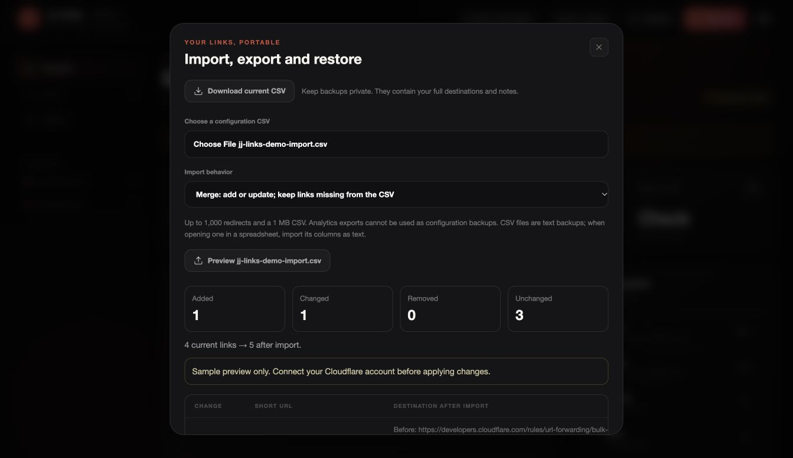

# CSV backups, import and restore

Use **Import / export → Download current CSV** for a complete configuration backup. It contains source, destination, status, matching options and notes. Cloudflare item IDs are intentionally omitted because they can change when a list is restored.

Keep the file private. It may contain private document links and notes. CSV is plain text; spreadsheet programs may interpret arbitrary text as formulas, so import its columns as text rather than trusting an unknown file.



## Format

Required headers are `source_url`, `target_url` and `status_code`. Optional boolean fields use `true` or `false`:

```csv
"source_url","target_url","status_code","include_subdomains","subpath_matching","preserve_path_suffix","preserve_query_string","comment"
"go.example.com/docs","https://example.com/docs","301","false","false","false","true","Documentation"
"ai.example.com/event","https://example.com/event?id=42","302","false","false","false","false","Temporary event link"
```

301 and 308 are permanent redirects; 302 and 307 are temporary. An incoming query cannot be preserved when the destination already has a fixed query, because that would discard the fixed destination query.

Source hostnames must match your configured pair. Preserve the exact path case and any existing source scheme when updating a current entry. Duplicate/overlapping paths, invalid status codes, credentials in URLs, malformed CSV and invalid booleans are rejected before a preview can be applied.

Quoted commas, quotes, Unicode and multiline notes are supported. A blank source row is not a deletion instruction. Segmented analytics exports are rejected.

## Merge

Listed rows add or update links. Unlisted links remain. Review destination changes and any changed status, matching option or note. A preview performs no Cloudflare write.

## Restore

The complete resulting list matches the file. The preview shows links that will be removed. Type `RESTORE <current count>` and confirm the reviewed changes before applying.

The app saves a full pre-import D1 snapshot first. Download that backup after the import; use it for a reviewed reverse restore if needed.

## Confirmation and verification

The server expires previews after 15 minutes and ties them to both your user and selected list. If anything changed after preview, make a new comparison.

Configuration confirmation and public edge verification are different states. The app can truthfully report saved configuration while public checks are still pending. Retry public checks without importing the file again.

An interrupted import can be resumed from **Import / export** in the same browser tab. It checks the original saved request instead of issuing the write twice.

The file limit is 1 MB and the resulting list must contain at most 1,000 links. The complete stored preview also has a safety limit below [D1's 2 MB row limit](https://developers.cloudflare.com/d1/platform/limits/); exceptionally long destinations or notes can reach it earlier. Rejection at preview does not change the live list.

Removing an originless link can leave its public check pending if the hostname returns an origin error rather than a definitive non-redirect response. The full Cloudflare readback still establishes which entries are saved; an HTTP server error alone is not proof of public removal.
